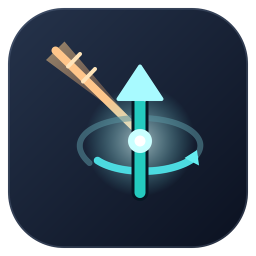
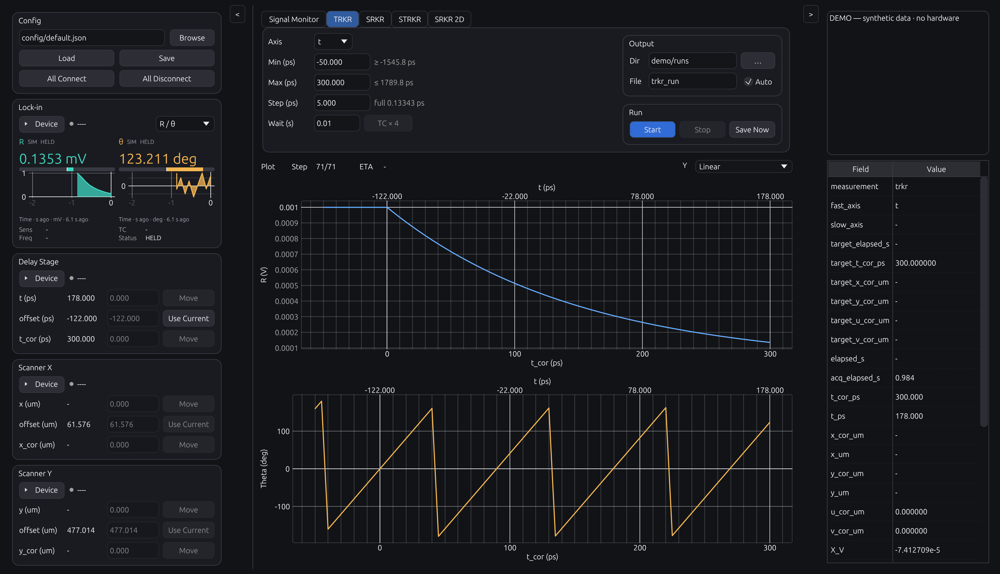

# KohdaLab TRKR

[](https://github.com/woolen-yarn/kohdalab-trkr/actions/workflows/test.yml)
[](https://github.com/woolen-yarn/kohdalab-trkr/releases/latest)
[](LICENSE)

Rust desktop application for time-resolved Kerr rotation measurements, live lock-in monitoring, and stage/scanner control.

時間分解カー回転測定、ロックインのライブ表示、ステージ・スキャナ制御を行うRust製デスクトップアプリです。

[Download / ダウンロード](https://github.com/woolen-yarn/kohdalab-trkr/releases) · [Documentation / 文書](docs/README.md) · [Report an issue / 問題の報告](https://github.com/woolen-yarn/kohdalab-trkr/issues)

- Signal Monitor, TRKR, SRKR, STRKR, and SRKR 2D. / 信号モニターと4種の測定に対応。
- Live XY/Rθ traces, retained spatial scans, rotated u/v axes, and heatmaps. / XY/Rθのライブ表示、空間スキャンの結果保持、回転u/v軸、ヒートマップ。
- Shared Rust measurement engine for the desktop GUI and optional Python/Jupyter client. / GUIと任意のPython/Jupyterクライアントで同じRust測定エンジンを使用。

## Interface / 画面



Synthetic TRKR data; no instruments connected. The same interface is used on Windows and macOS.

合成TRKRデータの表示例です。実機は接続していません。Windows・macOSで同じ画面構成を使用します。

## Downloads / ダウンロード

| Channel / 配布区分 | Version / バージョン | Platforms / 対応環境 |
| --- | --- | --- |
| Stable / 安定版 | [0.4.0](https://github.com/woolen-yarn/kohdalab-trkr/releases/tag/v0.4.0) | Windows x64 Setup / portable ZIP; macOS Apple silicon DMG / ZIP |

Rust and Python are not required to run the packaged application. Current Windows
artifacts are unsigned; download packages and checksums together from Releases.
macOS bundles use ad hoc signing and are not Apple-notarized.

配布版の実行にRustやPythonのインストールは不要です。現在のWindows版は未署名です。Releasesからパッケージとチェックサムを一緒に取得してください。macOS版はアドホック署名で、Appleの公証は受けていません。

## Supported hardware / 対応機器

| Role / 役割 | Implemented models / 実装済み機種 |
| --- | --- |
| Lock-in / ロックイン | SR7265, SR830, SR5210, LI5640 |
| Delay controller / 遅延ステージ制御 | SHOT302GS, GSC01, GSC01A |
| Scanner controller / スキャナ制御 | CONEX-CC, CONEX-AGAP |

See [hardware and transport](docs/reference/hardware.md) for stage/actuator presets, GPIB adapters, and validation scope. Implemented protocol support does not imply physical qualification of every device/firmware combination.

ステージ・アクチュエータのプリセット、GPIBアダプター、確認範囲は[対応機器と通信](docs/reference/hardware.md)を参照してください。プロトコルの実装は、すべての機器・ファームウェアの組合せを実機検証済みという意味ではありません。

## Quick start / はじめに

1. Install the application or extract the complete portable package. / アプリをインストールするか、portable版をフォルダーごと展開します。
2. Explore synthetic data using the separate Demo application before connecting hardware. / 実機を接続する前に、専用Demoアプリで合成データを試します。
3. Load a reviewed profile, check the selected devices, ports, origins, calibration, and limits, then connect deliberately. / 確認済み設定を読み込み、機器・ポート・原点・校正・制限を確認してから接続します。
4. Choose a workflow and output location. Keep the CSV and its `.run.json` metadata together. / 測定と保存先を選びます。CSVと付随する`.run.json`は一緒に保管してください。

Python/Jupyter access / Python・Jupyterからの利用: [client guide](bindings/python/README.md) · [notebooks](notebook/).

## Development / 開発

Run commands from the repository root. The root `Cargo.toml` and `Cargo.lock`
are the workspace entry point; product packages live under `crates/`.

コマンドはリポジトリのルートで実行します。ルートの`Cargo.toml`と`Cargo.lock`がワークスペースの入口で、Rustパッケージは`crates/`に配置しています。

```sh
cargo test --workspace --locked
cargo build --release --locked
cargo run --locked --bin kohdalab-trkr
```

```text
crates/       Rust application, measurement core, motion, and transport / アプリ・測定・移動・通信
bindings/     Thin Python/Jupyter client / Python・Jupyter用の薄いクライアント
native/       Isolated native helpers and upstream notices / 独立helperと権利表記
notebook/     Rust-backed notebook examples / Rustを使うNotebook例
scripts/      Build, package, and validation entry points / ビルド・配布・検証
tests/        Packaging/client tests and frozen reference fixtures / 配布・連携テストと固定参照
docs/         Guides, development notes, references, validation, images / 操作・開発・仕様・検証・画像
```

See [repository layout](docs/development/repository-layout.md) and
[CONTRIBUTING.md](CONTRIBUTING.md) before changing device or build boundaries.
Tests must not connect hardware, move stages, enable outputs, or alter drivers.

機器制御やビルドの境界を変更する前に、[構成ガイド](docs/development/repository-layout.md)と[開発への参加](CONTRIBUTING.md)を参照してください。テストで実機接続・移動・出力ON・ドライバー変更を行わないでください。

## Documentation / ドキュメント

- [Documentation index](docs/README.md): the entry point for all guides and references. / 全ガイド・仕様書の入口。
- `docs/guides/`: installation and everyday operation. / インストールと日常操作。
- `docs/development/`: architecture, extension points, and build/release maintenance. / 設計・拡張・ビルドとリリース保守。
- `docs/reference/`: hardware, protocols, formats, and compatibility contracts. / 機器・通信・形式・互換性。
- `docs/validation/`: versioned evidence and measured limitations. / バージョン別の検証記録と制約。
- `docs/images/`: repository screenshots and figures. / 画面と図。

## KohdaLab applications / KohdaLabのアプリケーション

[IV](https://github.com/woolen-yarn/kohdalab-iv) · [TRKR](https://github.com/woolen-yarn/kohdalab-trkr) · [Camera](https://github.com/woolen-yarn/kohdalab-camera)

The applications share a root Cargo workspace, `crates/` source packages, focused
build scripts, and the same documentation categories. Hardware backends and
qualification remain product-specific.

3製品でルートCargo、`crates/`、目的別のビルドスクリプト、文書分類を共通化しています。機器バックエンドと実機の確認範囲は製品ごとに管理します。

## License / ライセンス

Project code is [MIT licensed](LICENSE). Native helpers and redistributed
dependencies retain their own licenses; keep the accompanying notices and source.
See [redistribution terms](REDISTRIBUTION.md), [code signing](CODE_SIGNING_POLICY.md), and [privacy](PRIVACY.md).

独自コードは[MITライセンス](LICENSE)です。ネイティブhelperと再配布する依存物にはそれぞれのライセンスが適用されます。権利表記と対応するソースを保持してください。[再配布条件](REDISTRIBUTION.md)・[コード署名](CODE_SIGNING_POLICY.md)・[プライバシー](PRIVACY.md)も参照してください。
