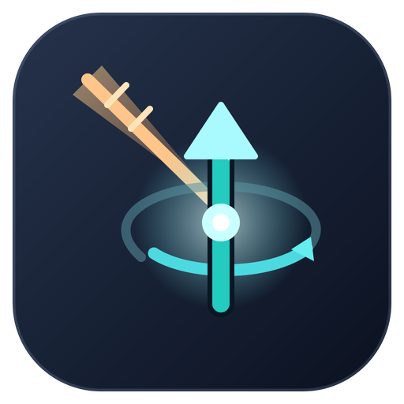
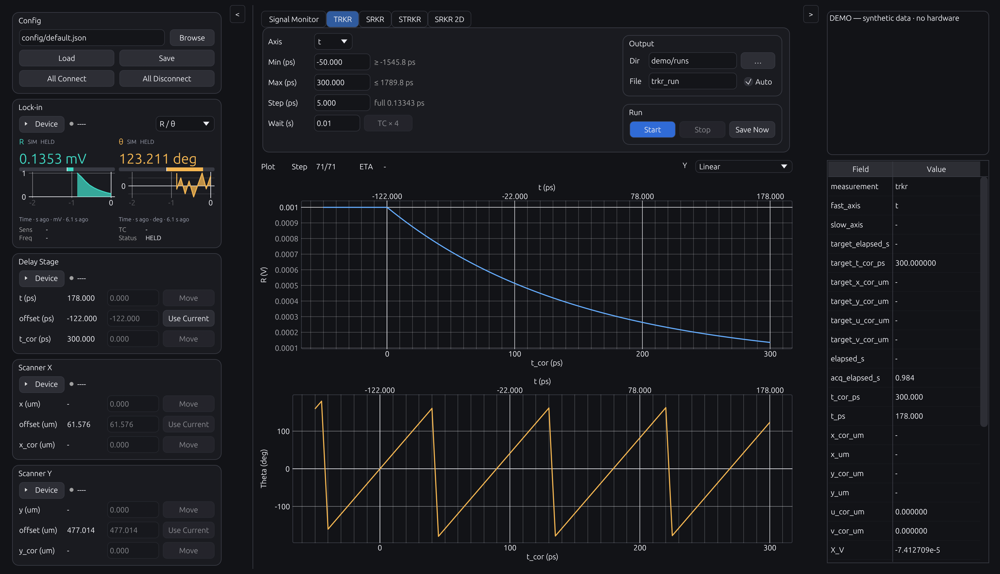

# KohdaLab TRKR

[](https://github.com/woolen-yarn/kohdalab-trkr/actions/workflows/test.yml)
[](https://github.com/woolen-yarn/kohdalab-trkr/releases/latest)
[](LICENSE)

Rust desktop application for time-resolved Kerr rotation measurements, live lock-in monitoring, and stage/scanner control.

時間分解カー回転測定、ロックインのライブ表示、ステージ・スキャナ制御を行うRust製デスクトップアプリです。

[Download / ダウンロード](https://github.com/woolen-yarn/kohdalab-trkr/releases) · [Documentation / 文書](docs/README.md) · [Report an issue / 問題の報告](https://github.com/woolen-yarn/kohdalab-trkr/issues)

- Signal Monitor, TRKR, SRKR, STRKR, and SRKR 2D. / 信号モニターと4種の測定に対応。
- Live XY/Rθ traces, retained spatial scans, rotated u/v axes, and heatmaps. / XY/Rθのライブ表示、空間スキャンの結果保持、回転u/v軸、ヒートマップ。
- Shared Rust measurement engine for the desktop GUI and optional Python/Jupyter client. / GUIと任意のPython/Jupyterクライアントで同じRust測定エンジンを使用。

## Interface / 画面



Synthetic TRKR data; no instruments connected. The same interface is used on Windows and macOS.

合成TRKRデータの表示例です。実機は接続していません。Windows・macOSで同じ画面構成を使用します。

## Downloads / ダウンロード

| Channel / 配布区分 | Version / バージョン | Platforms / 対応環境 |
| --- | --- | --- |
| Stable / 安定版 | [Latest release / 最新版](https://github.com/woolen-yarn/kohdalab-trkr/releases/latest) | Windows x64 Setup / portable ZIP; macOS Apple silicon DMG / ZIP |

Rust and Python are not required to run the packaged application. Current Windows
artifacts are unsigned; download packages and checksums together from Releases.
macOS bundles use ad hoc signing and are not Apple-notarized.

配布版の実行にRustやPythonのインストールは不要です。現在のWindows版は未署名です。Releasesからパッケージとチェックサムを一緒に取得してください。macOS版はアドホック署名で、Appleの公証は受けていません。

## Supported hardware / 対応機器

| Role / 役割 | Implemented models / 実装済み機種 |
| --- | --- |
| Lock-in / ロックイン | SR7265, SR830, SR5210, LI5640 |
| Delay controller / 遅延ステージ制御 | SHOT302GS, GSC01, GSC01A |
| Scanner controller / スキャナ制御 | CONEX-CC, CONEX-AGAP |
| Power meter / パワーメータ | Thorlabs PM100USB, PM100D (Windows x64: VISA USBTMC, plus Thorlabs TLPMX/TLPM from 0.5.7 / Windows x64：VISA USBTMC、0.5.7からThorlabs TLPMX/TLPM) |

See [hardware and transport](docs/reference/hardware.md) for stage/actuator presets, GPIB adapters, and validation scope. Implemented protocol support does not imply physical qualification of every device/firmware combination.

ステージ・アクチュエータのプリセット、GPIBアダプター、確認範囲は[対応機器と通信](docs/reference/hardware.md)を参照してください。プロトコルの実装は、すべての機器・ファームウェアの組合せを実機検証済みという意味ではありません。

[Power-meter setup and recording / パワーメータの設定と記録](docs/guides/power-meter.md).

## Quick start / はじめに

1. Install the application or extract the complete portable package. / アプリをインストールするか、portable版をフォルダーごと展開します。
2. Explore synthetic data using the separate Demo application before connecting hardware. / 実機を接続する前に、専用Demoアプリで合成データを試します。
3. Load a reviewed profile, check the selected devices, ports, origins, calibration, and limits, then connect deliberately. / 確認済み設定を読み込み、機器・ポート・原点・校正・制限を確認してから接続します。
4. Choose a workflow and output location. Keep the analysis `.csv`, `.raw.csv`, `.log` and `.run.json` together. / 測定と保存先を選びます。解析用`.csv`・`.raw.csv`・`.log`・`.run.json`は一緒に保管してください。

[Config restoration and All Connect / Config復元とAll Connect](docs/guides/quick-start.md).

Python/Jupyter access / Python・Jupyterからの利用: [client guide](bindings/python/README.md) · [notebooks](notebook/).

Python can attach to the desktop GUI or launch it with a JSON profile, then exclusively control measurements, motion, and output settings while keeping the live plots and Stop available. / Pythonから既存GUIへ接続、またはJSON設定で新規起動し、ライブプロット・Stopを使いながら測定・移動・保存先を排他制御できます。

TRKR saves its user profile at `~/.kohdalab/trkr/config/config.json` (`%USERPROFILE%\.kohdalab\trkr\config\config.json` on Windows). Results default to `~/.kohdalab/trkr/results`, runtime API descriptors to `~/.kohdalab/trkr/run`, and logs to `~/.kohdalab/trkr/logs`. On the first normal launch, the profile is created from embedded safe defaults; this does not connect hardware or enable outputs. Existing valid, invalid, or future-version files are never replaced automatically. Demo settings use the separate `config/demo.json`. The standard installed locations are `C:\Program Files\Kohdalab\KohdaLab TRKR` and `/Applications/KohdaLab TRKR.app`. / TRKRのユーザー設定は`~/.kohdalab/trkr/config/config.json`（Windowsでは`%USERPROFILE%\.kohdalab\trkr\config\config.json`）に保存されます。結果は`~/.kohdalab/trkr/results`、実行時APIの検出ファイルは`~/.kohdalab/trkr/run`、ログは`~/.kohdalab/trkr/logs`です。通常の初回起動では内蔵の安全な既定値から自動作成されますが、機器接続や出力有効化は行いません。既存の有効・不正・将来版のファイルは自動で置き換えません。Demo設定は`config/demo.json`を使用します。標準のインストール先は`C:\Program Files\Kohdalab\KohdaLab TRKR`と`/Applications/KohdaLab TRKR.app`です。

## Saved data / 保存仕様

| File / ファイル | Contents / 内容 |
| --- | --- |
| `<name>.csv` | Analysis signals, units, actual/target coordinates and quality flags. Optional corrected `sample_power_W` uses four significant digits; delay decimals use observed ps/pulse with a guard decimal. These are formatting rules, not accuracy guarantees. / 解析用信号・単位・実測／指令座標・品質フラグ。任意の補正済み`sample_power_W`は有効4桁、遅延の桁数は実測ps/pulseに予備1桁を加えた表記で、いずれも確度の保証ではありません。 |
| `<name>.raw.csv` | Exact decoded device replies, native scanner/stage readings, unrounded delay and optional power values, timing windows and errors. Idle live polling is excluded. / 装置の文字列応答、scanner／stageの生読取、丸め前の遅延・任意のパワー値、取得時間窓・エラー。待機中のライブ照会は含めません。 |
| `<name>.log` | Run lifecycle, saved-point progress and errors. / 開始・保存点の進行・終了・エラー。 |
| `<name>.run.json` | Plan, device assignments/calibration, observed start settings, numeric-format policy, software identity, completion state and file hashes. / 測定計画・機器割当・校正、開始時の読戻し設定、数値表記規則、ソフトウェア情報、終了状態・ハッシュ。 |

From 0.5.2, the run-start lock-in snapshot includes reference phase, source and harmonic for SR5210/SR7265/SR830/LI5640. This reference phase is distinct from measured signal `Theta_deg`. Read failures remain explicit; front-panel changes during a run are not continuously recorded. See [measurement integrity](docs/reference/measurement-integrity.md) for precision and limitations.

0.5.2からSR5210／SR7265／SR830／LI5640の開始時スナップショットに参照位相・参照源・高調波次数を保存します。参照位相は信号の`Theta_deg`とは別です。読取失敗は明示し、測定途中の本体設定変更を連続記録するものではありません。桁数と制約は[測定記録の仕様](docs/reference/measurement-integrity.md)を参照してください。

## Development / 開発

[Multiple devices and Alignment / 複数機器とAlignment](docs/guides/multiple-devices-alignment.md): per-measurement Settings and device selection, manual alignment and optical round trips. / 測定ごとのSettings・機器選択、複数接続、手動アライメント、光路往復数。

[Shared GPIB development mode / 複数アプリのGPIB共有・開発版](docs/development/shared-instruments.md) is opt-in; the separate hub executable is not bundled. / 任意の開発用接続であり、共有サービスの実行ファイルは同梱しません。

Run commands from the repository root. The root `Cargo.toml` and `Cargo.lock`
are the workspace entry point; product packages live under `crates/`.

コマンドはリポジトリのルートで実行します。ルートの`Cargo.toml`と`Cargo.lock`がワークスペースの入口で、Rustパッケージは`crates/`に配置しています。

```sh
cargo test --workspace --locked
cargo build --release --locked
cargo run --locked --bin kohdalab-trkr
```

```text
crates/       Rust application, measurement core, motion, and transport / アプリ・測定・移動・通信
bindings/     Thin Python/Jupyter client / Python・Jupyter用の薄いクライアント
native/       Isolated native helpers and upstream notices / 独立helperと権利表記
notebook/     Rust-backed notebook examples / Rustを使うNotebook例
scripts/      Build, package, and validation entry points / ビルド・配布・検証
tests/        Packaging/client tests and frozen reference fixtures / 配布・連携テストと固定参照
docs/         Guides, development notes, references, validation, images / 操作・開発・仕様・検証・画像
```

See [repository layout](docs/development/repository-layout.md) and
[CONTRIBUTING.md](CONTRIBUTING.md) before changing device or build boundaries.
Tests must not connect hardware, move stages, enable outputs, or alter drivers.

機器制御やビルドの境界を変更する前に、[構成ガイド](docs/development/repository-layout.md)と[開発への参加](CONTRIBUTING.md)を参照してください。テストで実機接続・移動・出力ON・ドライバー変更を行わないでください。

### Python GUI stop policies / Python GUIの停止条件

GUI automation supports independent `stop_on_disconnect`, `stop_on_error` (exception escaping `with`), and `stop_on_timeout` options. TRKR defaults to continuing the active job. `stop_and_wait()` verifies its terminal receipt; typed errors distinguish transport, ownership, device, initialization, and saving failures. See [Python usage and stop conditions](bindings/python/README.md#stop-conditions--停止条件).

GUI外部制御では通信失効・`with`内のPython例外・待機タイムアウトの停止条件を個別指定できます。TRKRの既定は継続です。停止完了待ちと例外分類を含む[英日APIガイド](bindings/python/README.md#stop-conditions--停止条件)を参照してください。

### Common GUI control / 共通GUI制御

[Control Protocol 1 and Python/Notebook examples / 共通APIとPython・Notebook](docs/reference/common-control-api.md). The existing application API remains supported; operation payloads and safety policy are app-specific. Camera is read-only. / 既存APIは維持し、操作引数と安全方針は各アプリに従います。Cameraは読み取り専用です。

See [Measurement output bundles / 測定データの保存セット](docs/reference/measurement-output.md) for common file roles and unit conventions.

## Documentation / ドキュメント

- [Documentation index](docs/README.md): the entry point for all guides and references. / 全ガイド・仕様書の入口。
- `docs/guides/`: installation and everyday operation. / インストールと日常操作。
- `docs/development/`: architecture, extension points, and build/release maintenance. / 設計・拡張・ビルドとリリース保守。
- `docs/reference/`: hardware, protocols, formats, and compatibility contracts. / 機器・通信・形式・互換性。
- `docs/validation/`: versioned evidence and measured limitations. / バージョン別の検証記録と制約。
- `docs/images/`: repository screenshots and figures. / 画面と図。

## KohdaLab applications / KohdaLabのアプリケーション

[IV](https://github.com/woolen-yarn/kohdalab-iv) · [TRKR](https://github.com/woolen-yarn/kohdalab-trkr) · [Camera](https://github.com/woolen-yarn/kohdalab-camera) · [Shutter](https://github.com/woolen-yarn/kohdalab-shutter)

IV, TRKR, and Camera each use a root Cargo workspace, `crates/` source packages, focused
build scripts, and the same documentation categories. Hardware backends and
qualification remain product-specific.

IV・TRKR・CameraでルートCargo、`crates/`、目的別のビルドスクリプト、文書分類を共通化しています。機器バックエンドと実機の確認範囲は製品ごとに管理します。

## License / ライセンス

Project code is [MIT licensed](LICENSE). Native helpers and redistributed
dependencies retain their own licenses; keep the accompanying notices and source.
See [redistribution terms](REDISTRIBUTION.md), [code signing](CODE_SIGNING_POLICY.md), and [privacy](PRIVACY.md).

独自コードは[MITライセンス](LICENSE)です。ネイティブhelperと再配布する依存物にはそれぞれのライセンスが適用されます。権利表記と対応するソースを保持してください。[再配布条件](REDISTRIBUTION.md)・[コード署名](CODE_SIGNING_POLICY.md)・[プライバシー](PRIVACY.md)も参照してください。
