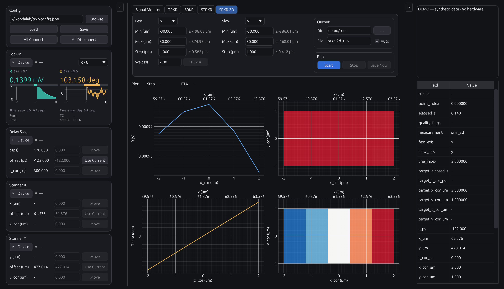

# KohdaLab TRKR

[](https://github.com/woolen-yarn/kohdalab-trkr/actions/workflows/test.yml)
[](https://github.com/woolen-yarn/kohdalab-trkr/actions/workflows/release.yml)
[](LICENSE)

Native Rust application for time-resolved Kerr rotation experiments. The GUI,
measurement planning, lock-in protocols, stage/scanner control, CSV recording and
CSV demo playback run without Python. A small optional Python client calls the
same Rust engine from Jupyter notebooks.

## Install

Download from [Releases](https://github.com/woolen-yarn/kohdalab-trkr/releases).

- **Windows x64:** run `KohdaLab-TRKR-0.3.4-Setup.exe` for a per-user installation
  with a desktop shortcut, or extract the entire portable ZIP and run
  `kohdalab-trkr.exe`. `kohdalab-trkr-demo.exe` replays CSVs without hardware.
- **macOS Apple silicon, macOS 13+:** open the DMG and drag **KohdaLab TRKR.app**
  and optionally **KohdaLab TRKR Demo.app** to Applications. The Mac build uses an
  ad hoc signature; if Gatekeeper requires confirmation, use Finder's Open action.
- Current Windows binaries are unsigned. SignPath application preparation is
  documented in [Code signing](CODE_SIGNING_POLICY.md); acceptance is not claimed.

The application starts disconnected. Configure ports, resources, coordinate
origins, travel limits and calibration before using instruments. Existing JSON
profiles and legacy CSVs are supported; remaining Python interface differences are
listed in the [compatibility audit](docs/trkr_portable_rust.md). User-created profiles and measurement data
are preserved on uninstall. The installer does not install or replace drivers.

## Workflows

Signal Monitor, TRKR, SRKR, STRKR and SRKR 2D share one engine and CSV schema.
XY/Rθ displays, SI-scaled live signals, positive-value TRKR log plots, Python-compatible
heatmaps, rotated u/v scans and paired-axis validation are included. Step displays
acquired/total points (for example `9/41`), independent of retained plot history.
Moving, Waiting and Reading appear beside the relevant device names.

## GUI

Screenshots from the native macOS application using synthetic demo data, with
no instruments connected. Windows uses the same GUI. The dark layout, device
readouts, live XY/Rθ traces, fixed side panels and plots share one implementation.

**TRKR — time trace with R/θ display and Linear/Log selection**


**SRKR 2D — line profiles and spatial heatmaps**



## Supported instruments

The following models are implemented in the Rust drivers. Protocols are covered
by simulated-I/O tests; this is not a claim that every hardware/firmware
combination has been tested on a physical apparatus. See the
[compatibility audit](docs/trkr_portable_rust.md) for the verification scope and
legacy maintenance operations that are outside the measurement API.

| Category | Model / family | Connection | Implemented measurement operations |
| --- | --- | --- | --- |
| Lock-in | SR7265 | GPIB | XY/Rθ acquisition, sensitivity, time constant, coupling, slope, AC gain, auto actions |
| Lock-in | SR830 | GPIB | XY/Rθ acquisition, sensitivity, time constant, coupling, slope, auto actions |
| Lock-in | SR5210 | GPIB | XY/Rθ acquisition, sensitivity, time constant, slope, auto actions; AC coupling only |
| Lock-in | LI5640 | GPIB | XY/Rθ acquisition with display restoration, sensitivity, time constant, coupling, slope, auto actions |
| Delay controller | SHOT302GS | Serial | Position readback, absolute moves, microstep readout, initialization/home, normal Stop |
| Delay controller | GSC01 / GSC01A | Serial | Position readback, absolute moves, microstep readout, initialization/home, normal Stop |
| Scanner controller | CONEX-CC | Serial | Position readback, absolute moves, home/initialization, Stop, configurable software hysteresis compensation |
| Scanner controller | CONEX-AGAP | Serial | U/V axis control, position readback, absolute moves, closed-loop initialization and Stop |

Built-in motion presets supply defaults; experiment origins, sample conversion,
direction and limits remain profile settings.

| Stage / actuator preset | Controller | Native travel / unit |
| --- | --- | --- |
| SGSP46-500 | SHOT302GS | 500 mm travel |
| OSMS20-35 | SHOT302GS / GSC01 / GSC01A | 35 mm travel |
| OSMS26-300 | SHOT302GS / GSC01 / GSC01A | 300 mm travel |
| OSMS33-600 | SHOT302GS | 600 mm travel |
| TRA12CC | CONEX-CC | 0–12 mm |
| AG-M100D | CONEX-AGAP | −0.75–+0.75° |

GPIB supports primary addresses 1–30. On Windows, the application can use a
system **64-bit VISA runtime** for the selected `GPIB0::<address>::INSTR` resource.
The separate native USB-GPIB helper supports **NI USB-GPIB-HS+** and an
**already initialized Agilent 82357B**. Drivers and adapter initialization are
not bundled. VISA failures do not trigger a native-adapter fallback. On macOS,
serial devices use their `/dev/cu.*` ports. See
[transport setup and limitations](docs/trkr_portable_rust.md) and
[native helper details](native/README.md).

The demo bundles synthetic CSVs only. Experimental CSVs in a local `demo_csv/`
directory are ignored by Git and never copied into release artifacts.

## Notebook access

```sh
python -m pip install .
# Optional Jupyter tools:
python -m pip install '.[notebook]'
```

See [the thin client](bindings/python/README.md) and the six examples in
[`notebook/`](notebook). They automatically find installed Windows/macOS applications
or a nearby portable package. They default to simulation and require an explicit
hardware opt-in. All instrument I/O, scan validation and CSV writing remain in Rust.
The former Python GUI, drivers and experiment engine were removed in v0.3.0;
old releases remain available in Git history and Releases.

## Build and test

```sh
cargo test --manifest-path next/Cargo.toml --locked
cargo clippy --manifest-path next/Cargo.toml --all-targets --locked -- -D warnings
cargo build --manifest-path next/Cargo.toml --release --locked
python -m pip install pytest
python -m pytest tests
bash scripts/build_native.sh
```

Rust is pinned in `rust-toolchain.toml`. For native helper prerequisites and
relinking instructions, see [native/REBUILDING.md](native/REBUILDING.md).

```sh
python scripts/build_release.py --platform macos-arm64 \
  --binaries-dir next/target/release --native-dir build/native --output dist
# In Windows/MSYS2 use --platform windows-x64; NSIS must be available on PATH.
```

GitHub Actions runs Rust and packaging/client tests on Linux, Windows and macOS.
Tag `v<workspace version>` builds both distributions from source and publishes
only after all jobs pass. Artifacts include corresponding source, dependency
notices, checksums and build-origin metadata. The external GPL helper is kept
separate from the first-party SignPath signing set. See [redistribution](REDISTRIBUTION.md).

Checksums identify the exact artifacts from a CI run. Source/portable ZIP entry
timestamps are normalized; platform linker signatures and DMG filesystem metadata
are not promised to be bit-for-bit identical across independent builds.
