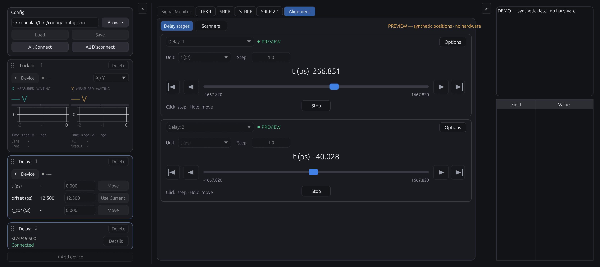
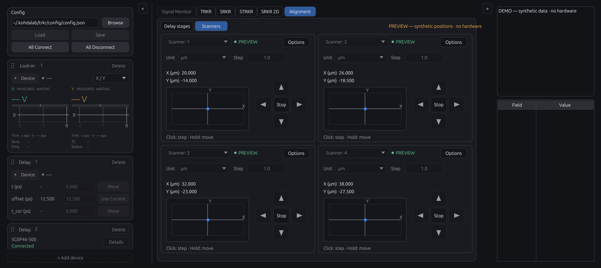
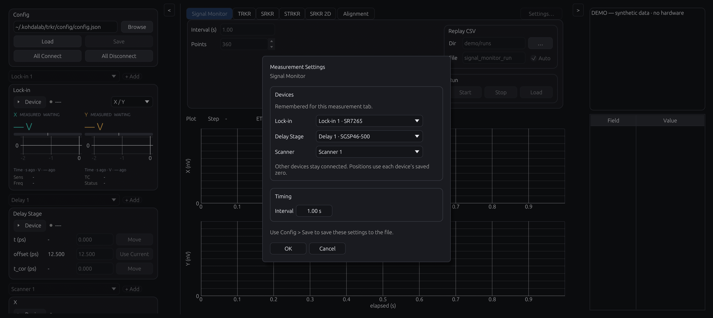
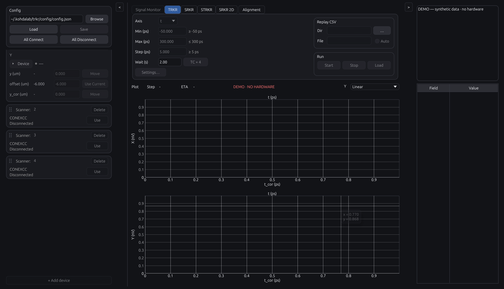
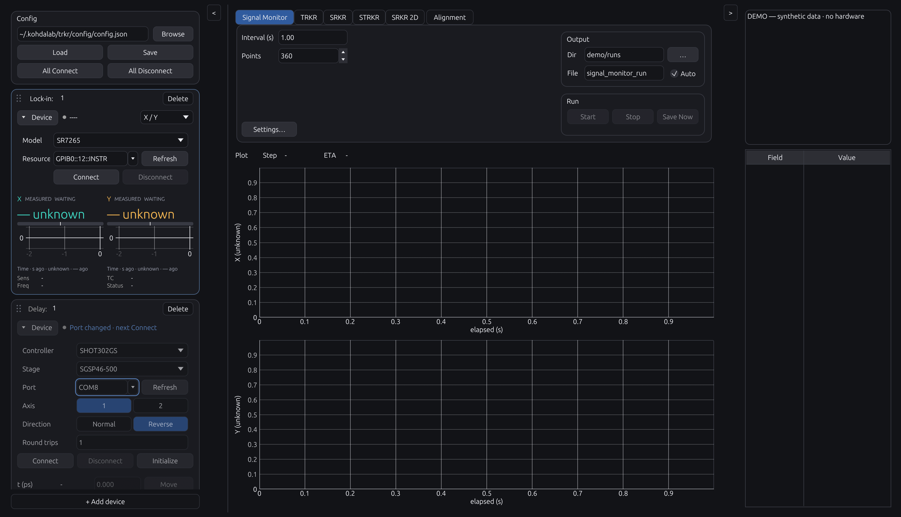

# Multiple devices and Alignment / 複数機器とアライメント

Development branch feature; not included in the published v0.4.10 packages.

開発ブランチの機能です。公開済みv0.4.10の配布物には含まれません。

## Preview / 画面

Development capture, 2026-11-05, macOS Retina 2×. Synthetic positions only;
movement controls are disabled. / 2026-11-05の開発版・macOS Retina 2倍で撮影。
合成位置を使用し、実機の移動操作は無効です。

## Connections and measurement selection / 接続と測定対象

**Settings…** sits below **Wait**, at the lower left of the measurement controls
(the same position for Signal Monitor). It shows only the instruments needed by
that measurement. **OK** applies the choice; **Cancel** discards it. Timing stays
in the existing Wait/Interval field. Use **Config → Save** to persist the profile.

**Settings…** は操作パネル左下の **Waitの下** に配置しています（Signal Monitorも
同じ位置）。測定に必要な機器のみ選択できます。**OK** で反映、**Cancel** で破棄し、
待ち時間は従来のWait/Interval欄で設定します。JSONへの保存は **Config → Save** です。

**Ctrl+Enter** starts the current measurement when Start is available, including
CSV replay. It does not start from Alignment, an open dialog or menu, during
another operation, or while Python owns the GUI. Holding the keys does not restart
the run. On macOS, use Control, not Command.

**Ctrl+Enter** で、Startボタンが使える状態の測定を開始できます（CSV再生も対応）。
Alignment・ダイアログ／メニュー表示中・別処理中・Python操作中には開始しません。
キーを押し続けても再開始しません。MacでもCommandではなくControlです。

| Measurement / 測定 | Devices shown / 選択する機器 |
| --- | --- |
| Signal Monitor | Lock-in |
| TRKR | Lock-in + Delay |
| SRKR / SRKR 2D | Lock-in + Scanner |
| STRKR | Lock-in + Delay + Scanner |

Each tab remembers its choices. Other connected instruments and their position
context remain available. Required devices are highlighted; other device cards
are subdued. **Use** assigns a device to the visible tab. Each device retains
its calibration and coordinate zero; tabs using the same device share that zero.
The spatial rotation angle remains shared.

組合せはタブごとに記憶します。他の機器の接続・位置記録も維持されます。
測定に必要な機器を明るく表示し、その他は控えめに表示します。**Use** で表示中タブに
割り当てます。校正・座標ゼロは装置ごとに保持し、同じ装置を使う測定タブはゼロを
共有します。空間座標の回転角は従来どおり共通です。

Switching measurement tabs preserves the open left-side device cards and their
Device disclosure state. Highlighting follows the tab's assigned devices (or the
running measurement while busy). **Details** explicitly chooses a card to
inspect; **Use** changes the measurement assignment. Start uses the selected
workflow's devices, even when a different card is being inspected. Explicit
assignment changes still wait for worker confirmation and roll back on failure.
Alignment panel bindings remain independent.

測定タブを切り替えても、左側で開いている機器カードとDeviceの開閉状態を保ちます。
強調表示はタブの割当機器（測定中は実行中の機器）に従います。**Details** で表示するカードを
選び、**Use** で測定の割当を変更します。別のカードを表示していても、Startは測定に
割り当てた機器を使用します。割当を明示的に変えた場合は制御側の確認を待ち、失敗時は
元に戻します。Alignmentのパネル割当は独立です。

Use **+ Add device** at the bottom of the left panel and choose **Lock-in / Delay /
Scanner**. The button stays visible while device cards scroll. Click the name in
the card header to rename it: **Scanner: 1** becomes **Scanner: Pump**, for example.
Clearing the label restores the automatic number. Labels also appear in
device-selection lists. Scanner X/Y stay
in one card. Configure the address/ports, controller, actuator and axes there.
A new motion device can be saved before a port is assigned; connecting and
measuring still require complete valid settings.

左パネル下端の **+ Add device** で **Lock-in / Delay / Scanner** を選びます。
カードをスクロールしてもAddは表示されます。見出しの名前を直接編集すると、
**Scanner: 1** を **Scanner: Pump** のように変更できます。名前を空にすると自動番号に
戻ります。名前は選択リストにも表示します。ScannerのX/Yは1枚のカードにまとめています。
ポート未設定でも追加・保存でき、接続・測定時には有効な設定が必要です。

Drag a card by the six-dot grip at its top left. The blue line marks its new
position; holding near the edge scrolls the list. Escape cancels the drag.
Reordering and renaming do not change device IDs, calibration or measurement
assignments. Use **Config → Save** to retain names and order.

カード左上の6点のつまみをドラッグすると、青い線の位置へ並べ替えられます。
上下端に近づけると自動スクロールし、Escapeで取り消せます。名前や順序を変えても、
機器ID・校正・測定の割当は変わりません。保存は **Config → Save** です。

**Delete** at the card's top right asks for confirmation. Disconnect the device
first. Its measurement assignments switch to the next device of that kind, or
become unconfigured if none remains. The profile currently requires at least one
lock-in, so add its replacement before deleting the last one. **Cancel** changes
nothing. Save the configuration to retain additions, labels and deletions.

カード右上の **Delete** は確認画面を表示します。削除前に対象機器を切断してください。
その機器を使う測定は同じ種類の次の機器に切り替わり、候補がなければ未設定になります。
現在のプロファイルはロックイン1台以上が必要なため、最後の1台を削除する場合は
先に代わりを追加します。**Cancel** では変更しません。追加・名前・削除をファイルに
残すにはConfigを保存してください。

Scanner axes can use separate CONEX-CC ports or U/V hardware axes of a shared
CONEX-AGAP controller. Hardware U/V differ from rotated measurement coordinates
u/v. Disconnect before editing controller, port, calibration or axis. Direction
has a dedicated live update that preserves the displayed coordinate.

ScannerはCONEX-CCの別ポート、またはCONEX-AGAPの共通接続の装置軸U/Vを使えます。
装置軸U/Vは回転測定座標u/vとは別です。制御器・ポート・校正・軸の変更は切断後に
行います。Directionは表示値を維持する専用の更新処理で接続中にも変更できます。

Expanded **Device** settings share this order: **Controller → Stage / Actuator →
Port → Axis → Direction → Round trips / Scale**. An edited field briefly gains a
blue outline and a “changed · next Connect” caption. These are local edits; use
Config → Save to retain them. Connected Direction changes show “Updating
direction…” until acknowledgement, then “Direction updated”; a failure is tied
to that device and axis rather than unrelated read errors.

**Device** 展開時は **Controller → Stage／Actuator → Port → Axis → Direction →
Round trips／Scale** の順に統一しています。変更欄を一時的に青枠で示し、
「changed · next Connect」と表示します。次回接続に使う設定で、保存はConfig → Saveです。
接続中のDirection変更は「Updating direction…」から、確認後に「Direction updated」へ
変わります。失敗表示は対象機器・軸の変更結果に基づき、別機器の読取エラーと区別します。

**All Connect** validates every configured entry before connecting in order.
If a connection fails, the log lists the connections retained; inspect the
device selectors or use **All Disconnect**. Duplicate physical endpoints are
rejected. A shared serial controller must use compatible communication settings.

**All Connect** は全設定を検証して順次接続します。途中で失敗した場合、ログに
維持された接続を表示します。機器選択で状態を確認するか、**All Disconnect** を
使用してください。同じ物理軸・アドレスの重複登録は拒否します。共通のシリアル
制御器には互換性のある通信設定が必要です。

## Alignment tab / Alignmentタブ

Alignment is a separate tab alongside Signal Monitor/TRKR/SRKR/STRKR/SRKR 2D.
Choose **Delay stages** for two horizontal stage panels or **Scanners** for
four panels in a 2×2 arrangement. Each panel independently selects a registered
device; changing a panel's device does not change the measurement selection.
The original controls and Initialize buttons in the left panel remain available.

AlignmentはSignal Monitor/TRKR/SRKR/STRKR/SRKR 2Dと並ぶ独立タブです。
**Delay stages** では横長の2パネル、**Scanners** では2×2の4パネルを表示します。
各パネルに登録済み機器を割り当てられ、測定対象の選択は変わりません。
左パネルの従来の操作・Initializeボタンも引き続き使えます。

Both views place **Unit / Step** at the top, with **Options** at the top right
and status beside the device name. There is no separate Step/Hold mode selector.
A click moves one step; holding the same arrow for about **0.35 s** begins Hold.
Releasing a held arrow requests stop and never adds a final single step.

両方とも上段に **Unit／Step**、右上に **Options**、機器名の横に状態を表示します。
Step/Holdのモード切替は不要です。同じ矢印をクリックすると1ステップ、約 **0.35秒**
押し続けるとHoldになります。長押しを離した際は停止要求のみで、追加の1ステップは出しません。

| Control / 操作 | Behavior / 動作 |
| --- | --- |
| Click arrow / 矢印クリック | One relative move by Step; spatial moves retain backlash compensation. / Step幅だけ移動。空間の位置指定移動では補償を維持します。 |
| Hold arrow / 矢印長押し | Bounded successive moves; release, focus loss or leaving Alignment requests stop. / 小区間の連続移動。解放・フォーカス喪失・タブ離脱で停止要求します。 |
| Outer end arrows / 外側の端移動ボタン | Delay only: move to the corresponding travel end in the selected coordinate direction. / Delayの可動端へ移動。選択座標の増減方向に対応します。 |
| Options → Initialize | Confirm reference/homing and optional coordinate-zero move; AGAP does not HOME. / 原点復帰・初期化と任意の座標ゼロ移動を確認。AGAPではHOMEしません。 |
| Stop | Cancel the active application motion. / アプリで進行中の移動を停止します。 |

Delay shows the current position and rail in the selected unit only, between the
left/right arrows. Scanner puts its coordinate graph on the left and the arrow
pad on the right, with Stop in the middle. One Step value applies to both axes.
Current values and graph/rail coordinates are recomputed from the latest device
offset; editing an offset updates corrected coordinates immediately.
**Options** opens a popup containing Direction and Initialize; opening it does
not change the card height. Initialize retains its separate confirmation.

Delayは選択した単位だけで現在値と位置バーを示し、その左右に移動ボタンを配置します。
Scannerは左に座標グラフ、右に十字ボタン、十字の中央にStopを配置し、X/Yで共通のStepを
使用します。現在値と目盛りは装置の最新offsetから算出し、offsetを編集すると補正座標も
自動更新します。**Options** はDirectionとInitializeをまとめたポップアップで、
カードの高さは変わりません。Initializeは別の確認画面を経て実行します。

The position/relative-motion grouping follows the
[Newport CONEX-CC interface](https://www.newport.com/medias/sys_master/images/images/hec/h8c/8797077700638/CONEX-CC-Controller-GUI-Manual.pdf)
and the jog controls in
[Thorlabs Kinesis](https://media.thorlabs.com/contentassets/5f57e82e38004e2aa5dfd0071bcf0732/kinesis_with_c_quick_start_guide.pdf).
These are interaction references; TRKR retains its own motion and stop behavior.

位置と相対移動のまとめ方はNewport CONEX-CC、Jog操作はThorlabs Kinesisの
インターフェースを参考にしています。操作の見せ方の参考であり、TRKRの移動・停止処理は
既存のものを使用します。

Delay input/display units are `t (ps)`, `t_cor (ps)`, or native `mm`.
The `t` and `t_cor` relative increments have the same scale. The rail shows
travel limits in the selected unit. Hold does not insert a
100 µm compensation excursion before every small segment and does not return to
zero on release. One motion job runs at a time; automatic measurement and manual
Alignment motion are mutually exclusive. Python GUI ownership also locks manual
Alignment operations. A disconnected UI lease prevents further Hold segments;
physical stop response still depends on the controller and transport.

遅延ステージの入力・表示単位は `t (ps)`、`t_cor (ps)`、装置の `mm` から選びます。
相対移動量としてのtとt_corの換算倍率は同じです。レールの可動範囲も選んだ単位で
表示します。Holdの各小区間に100 µmの補償往復を挿入せず、
解放後もゼロへ戻しません。移動処理は同時に1件で、自動測定と手動Alignmentは
排他です。PythonがGUIを所有している間も手動Alignmentを制限します。
GUIからの継続通知が失効すると次のHold区間を開始しませんが、実際の停止応答は
制御器・通信状態に依存します。

## Optical path and direction / 光路と方向

**Round trips** is a positive integer, default **1** for existing profiles:

`t_ps = direction_sign × 2 × round_trips × (position_mm − origin_mm) / 0.299792458`

One round trip gives approximately 6.67128 ps/mm. It is used consistently for
readback, targets, Step resolution and saved effective calibration.

**Round trips** は正の整数で、既存設定の既定値は **1往復** です。
1往復は約6.67128 ps/mmとなり、現在値・移動先・Stepの分解能・保存する実効校正に
共通の換算を使用します。

Changing **Normal / Reverse** reads the current native position, changes the
coordinate origin, and preserves the current displayed coordinate without
moving hardware. The corrected-coordinate offset is retained, so both the
physical and corrected displays stay continuous. The physical location of
coordinate zero changes and may lie outside travel. In that case, initialize
without the optional move to coordinate zero. The scanner's mechanical
compensation approach side is retained when its coordinate sign changes.

**Normal / Reverse** の変更では現在の装置位置を読み、座標原点を再計算して、
実機を動かさず現在の表示値を維持します。補正座標のオフセットも維持するので、
補正前・補正後の両方の表示が連続します。座標ゼロの物理位置は変わり、可動範囲外に
なる場合があります。その場合、初期化時の座標ゼロへの移動を外してください。
スキャナの補償は、座標の符号変更前と同じ機械的な側から接近するよう維持します。

## Model presets / 機種プリセット

Controller/actuator compatibility comes from the embedded TOML catalogs.
CONEX-CC offers TRA6CC, TRA12CC and TRA25CC; CONEX-AGAP offers AG-M100D.
TRA15CC is not listed because its manufacturer specification has not been
confirmed; it is not silently mapped to another actuator.

制御器とアクチュエータの組合せは、同梱TOMLの機種定義を共通で使用します。
CONEX-CCはTRA6CC・TRA12CC・TRA25CC、CONEX-AGAPはAG-M100Dを選択できます。
TRA15CCはメーカー仕様を確認できていないため、別機種への置換はせず、選択肢に含めていません。

## Configuration and records / 設定と記録

Old JSON profiles are imported as the first devices. Save explicitly to persist
the `device_inventory` list and its `selected` IDs. The selected devices remain
projected at the legacy `instruments` locations for existing workflows. The main
CSV still contains the one selected signal and its measurement coordinates;
native readbacks remain in raw CSV, and `.run.json` records the selected IDs,
configuration, round trips, direction and effective motion calibration.

従来JSONは各種類の1台目として読み込みます。明示的なSaveで`device_inventory`の
機器一覧と`selected`のIDを保存します。選択機器は従来の`instruments`にも反映し、
既存の測定処理を維持します。main CSVは選択した1台の信号と測定座標を保存し、
装置の生の読取値はraw CSV、選択ID・設定・往復数・方向・実効校正は`.run.json`に
記録します。

Python GUI clients can use `gui.select_devices(workflow="srkr", scanner="scanner-2")`
and wait for the returned receipt before starting the next run. Omitted kinds
retain that measurement's selection. When `workflow` is omitted, the visible
measurement tab is used. `gui.connect()` / `gui.disconnect()` with no device
list apply to the inventory; an explicit legacy list still addresses the
selected devices. The common API advertises `control.select_devices` for the
same operation.

Pythonからは `gui.select_devices(workflow="srkr", scanner="scanner-2")` の完了を
待って次の測定を開始できます。省略した種類の選択はその測定で維持します。
`workflow`を省略した場合は表示中の測定タブを使います。機器リストを省略した
`gui.connect()` / `gui.disconnect()` は一覧全体に適用し、従来の機器リストを
明示した場合は選択中の機器を操作します。共通APIの同じ操作名は
`control.select_devices`です。

These changes require automated and hardware qualification separately. Synthetic
screenshots and fake-controller tests do not qualify real motion on an apparatus.

自動試験と実機確認は区別しています。合成画面・模擬制御器の試験は実装の検証であり、
実験装置での移動を実機確認済みとするものではありません。
