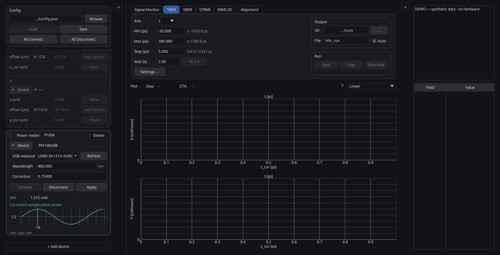

# Optional power meter (from 0.5.3) / 任意パワーメータ（0.5.3から）

Optional power recording for Thorlabs PM100USB/PM100D is available from 0.5.3. It does not certify any PM100USB/PM100D, sensor, firmware, driver, or laboratory setup.

Thorlabs PM100USB/PM100Dの任意パワー記録は0.5.3から利用できます。PM100USB/PM100D、センサー、ファームウェア、ドライバー、実験系の実機検証を示すものではありません。

## Set up / 設定

1. Use **+ Add device → Power meter**. The new card is appended at the bottom of the left device panel. / 左の機器パネルで**+ Add device → Power meter**を選びます。新しいカードは末尾に追加されます。
2. Open **Device** in the card, choose or enter the USB resource, then set sensor wavelength in nm and the positive sample correction factor. Press **Connect**. Settings are not applied while typing; use **Apply** after changing a connected meter. / カードの**Device**を開き、USB resourceを選択または入力し、センサー波長（nm）と正の試料補正係数を設定して**Connect**を押します。入力中は適用されません。接続済みメータを変更した場合は**Apply**を押します。
3. For each workflow, open **Measurement Settings** and choose **Power meter: None** or a registered meter. Adding a card does not enable it for every workflow. / 各workflowで**Measurement Settings**を開き、**Power meter: None**または登録済みメータを選びます。カードを追加しても全workflowで自動的に有効にはなりません。
4. Use **Config → Save** to retain the inventory, settings and workflow assignments. / 機器一覧・設定・測定ごとの割当を保存するには**Config → Save**を押します。

The left card shows corrected sample-plane power and a compact recent live plot. `LIVE`, `HELD`, `STALE`, and `ERROR` describe received state; no zero is invented when a read is absent.

左カードには補正済み試料面パワーと短いライブプロットを表示します。`LIVE`、`HELD`、`STALE`、`ERROR`は受信した状態を示し、読取がないときにゼロを作りません。

## Recording behavior / 記録の動作

The meter read follows the lock-in read sequentially; it is not a synchronized ADC acquisition. Idle live polls are display-only and are not written. In 0.5.7, for a selected available meter, main CSV records `sample_power_W`: native W/dBm is converted to W, then multiplied by the correction factor exactly once. Power never normalizes lock-in values and does not add a main lock-in plot.

メータ読取はロックイン読取の後に逐次実行され、同期ADC取得ではありません。待機中のlive pollは表示専用で保存しません。0.5.7では、選択済みで利用可能なメータの値をmain CSVの`sample_power_W`列に保存します。ネイティブW/dBmをWへ変換し、補正係数を一度だけ掛けます。パワーはロックイン値を正規化せず、main lock-in plotも追加しません。

Main CSV `sample_power_W` uses **four significant digits in scientific notation**, preserving trailing zeros: `1.23 mW × 0.75` becomes `9.225e-04` W, and 1 mW becomes `1.000e-03` W. Rounding occurs once, after unit conversion and sample correction, only when formatting the main CSV. Raw `power_read` keeps unrounded native, converted and corrected values and the factor; `transport_exchange` keeps the original reply text. Run JSON records the policy in `power_numeric_format`. A finite value at the f64 boundary that would round to infinity instead retains its shortest round-trip representation. Missing readings stay blank.

main CSVの`sample_power_W`は**有効4桁の指数表記**とし、末尾のゼロを残します。`1.23 mW × 0.75`は`9.225e-04` W、1 mWは`1.000e-03` Wです。単位換算・試料面補正の後、main CSVの文字列化時だけ一度丸めます。rawの`power_read`には丸め前のネイティブ値・W換算値・補正値・係数を、`transport_exchange`には元応答を保持します。run JSONの`power_numeric_format`に保存規則を記録します。f64上限付近で丸めにより無限大になってしまう有限値だけは、元の有限値を復元できる表記を維持します。欠測は空欄です。

Four digits define presentation, not verified measurement accuracy. Sensor calibration, noise and correction-factor uncertainty are not inferred from the number of digits typed or returned by the instrument. Internal calculations, API values, live plots, existing CSVs and Save Now copies are not rounded by this output rule.

4桁は保存表記の規則で、測定確度を保証しません。入力や装置応答の桁数から、センサー校正・ノイズ・補正係数の不確かさを推定しません。内部計算・API値・ライブプロット・過去CSV・Save Nowのコピーには、この出力時の丸めを適用しません。

If no meter is selected, existing profiles and measurements keep their original behavior. If a selected meter is missing or read fails, `sample_power_W` is blank and `power_unavailable` is recorded; the scan continues. Raw `power_read` records preserve native value/unit, converted and corrected values, wavelength/factor, device settings, exact exchanges, timing, and errors. Run JSON retains the meter identity and configuration.

メータ未選択なら既存profile・測定は従来どおり動作します。選択済みメータが見つからない、または読取に失敗した場合は`sample_power_W`を空欄にし、`power_unavailable`を記録してscanを継続します。rawの`power_read`にはネイティブ値／単位、変換値・補正値、波長／係数、装置設定、正確な通信、時刻、エラーを残します。run JSONにはメータidentityとconfigurationを残します。

## Platform and driver scope / プラットフォームとドライバー範囲

The published 0.5.6 and earlier builds use Windows x64 VISA USBTMC only. **From 0.5.7:** Windows x64 also supports installed Thorlabs TLPMX/TLPM drivers. For an empty resource field, Refresh searches TLPMX, then TLPM, then VISA only until devices are found. With an existing resource, Refresh searches only its selected backend. Clear the field to restart automatic discovery. Choose a resource prefixed with `TLPMX::` or `TLPM::` for that driver. Existing unprefixed `USB0::…::INSTR` profiles retain their VISA transport. No driver switch is requested when the installed Thorlabs driver can discover the meter.

公開済みの0.5.6以前はWindows x64のVISA USBTMCのみです。**0.5.7以降:** Windows x64ではインストール済みのThorlabs TLPMX/TLPMドライバーにも対応します。resource欄が空のときはTLPMX、TLPM、VISAの順に、機器が見つかるまで検索します。resourceが選択済みならその通信方式だけを検索します。自動検索をやり直すにはresource欄を空にしてください。公式ドライバーを使う場合は`TLPMX::`または`TLPM::`で始まるresourceを選択してください。既存の接頭辞なし`USB0::…::INSTR`設定はVISAを維持します。公式ドライバーで検出できる場合、ドライバーの切替は不要です。

Install the matching **64-bit** Thorlabs software/driver separately. Manufacturer DLLs are not bundled; Python is not required. Discovery errors identify the failed backend, so a missing VISA installation does not hide meters found by the native driver. macOS supports GUI/demo only, not physical power-meter access. See [Thorlabs' official driver examples](https://github.com/Thorlabs/Light_Analysis_Examples) for the supported driver families. Full hardware qualification is still pending. See [hardware and transport](../reference/hardware.md) for the scope of the physical TLPMX connection check.

対応する**64-bit版**のThorlabsソフトウェア／ドライバーを別途インストールしてください。メーカーDLLは同梱せず、Pythonも不要です。検出エラーは失敗した通信経路を示します。VISA未導入でも、公式ドライバーで検出した機器は表示します。macOSはGUI／Demoのみで、実機パワーメータには未対応です。対応ドライバーは[Thorlabs公式サンプル](https://github.com/Thorlabs/Light_Analysis_Examples)を参照してください。実機での包括的な検証は未実施です。TLPMX経由の実機接続を確認した範囲は[対応機器と通信](../reference/hardware.md)を参照してください。

The native adapter verifies a 10 s device communication timeout. It preserves averaging settings and accepts averaging below 9 s within the 25 s application read budget (including an in-flight live integration); longer settings produce an explicit error instead of being silently changed.

公式ドライバー経由では装置の通信タイムアウトを10秒に設定・読戻し確認します。平均化設定は勝手に変更せず、進行中のライブ取得の待ち時間も含むアプリの読取期限25秒に収まる9秒未満の設定を受け付けます。それ以上の場合は明示的なエラーにします。

Native-driver raw exchanges record the API name, arguments, status code and returned value instead of invented SCPI replies. The main CSV still uses the same corrected `sample_power_W` and four-significant-digit policy. Sensor/wavelength changes, relative mode, questionable data and driver failures do not become valid power samples.

公式ドライバー経由のraw通信には、SCPI応答を作らず、実際のAPI名・引数・ステータス・戻り値を記録します。main CSVの補正済み`sample_power_W`と有効4桁の規則は同じです。センサー／波長の変更、相対モード、異常データ、ドライバー失敗を正常なパワー値として採用しません。

## Preview / 表示例

Development capture from the v0.5.2-based `codex/optional-power-meter` source branch, macOS Apple silicon, 2× capture (3132 × 1600 pixels). Explicit `--gui-layout-smoke ... power-meter` synthetic fixture; no hardware connected. The device list is scrolled to its bottom: the power-meter card follows the lock-in, delay and scanner cards by default. Saved custom drag order is preserved.

v0.5.2基点の開発ブランチ`codex/optional-power-meter`による、macOS Apple siliconの2倍キャプチャー（3132 × 1600 px）です。明示的な`--gui-layout-smoke ... power-meter`の合成データで、実機は接続していません。機器リストを最下部までスクロールしています。パワーメータは既定ではLock-in・Delay・Scannerの後に配置し、保存済みのドラッグ順序は維持します。

## Connection troubleshooting / 接続できない場合

Connect opens the selected resource directly with reset disabled, then reads the model/serial from the open session. It does not repeat discovery or treat cached discovery availability as proof that another application owns the meter. If the actual open fails, the native driver error is shown. Close other TRKR/PLE/Thorlabs monitor sessions that are using this meter before retrying; never force-close a measurement in progress.

Connectは選択されたresourceをリセットせず直接開き、その接続から機種・シリアル番号を読み取ります。検索を繰り返したり、検索時の利用可否キャッシュだけで「別アプリが使用中」と断定したりしません。実際の接続が失敗した場合は公式ドライバーのエラーを表示します。同じメーターを使っている別のTRKR・PLE・Thorlabsモニターがあれば、その測定を安全に終了してから再試行してください。
